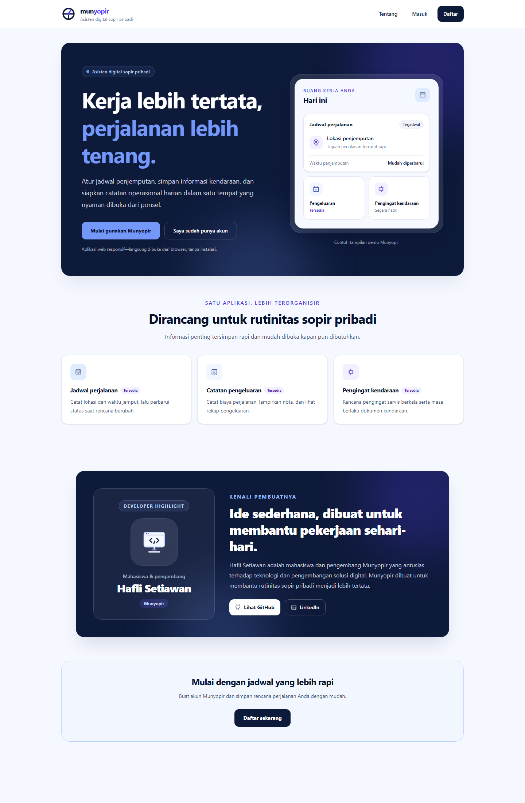

# PBAI-Project-Munyopir

**Munyopir** adalah aplikasi asisten digital untuk manajemen jadwal sopir pribadi, pencatatan pengeluaran operasional, dan pengingat perawatan kendaraan. Aplikasi ini membantu pengemudi mengelola perjalanan, kendaraan, dan kebutuhan harian dalam satu tempat yang responsif untuk desktop maupun ponsel.

## Pratinjau aplikasi

Ilustrasi berikut menunjukkan halaman dashboard dalam tata letak desktop dan mobile. Tampilan mobile menggunakan navigasi bawah agar fitur utama mudah dijangkau.

Halaman publik Munyopir menampilkan ringkasan manfaat aplikasi dan dapat dibuka tanpa membuat akun.



## Fitur

- **Akun pengguna:** daftar dan masuk, ubah nama serta email, ganti foto profil dan kata sandi, lalu keluar dengan konfirmasi.
- **Dashboard:** akses cepat ke fitur utama, ringkasan kendaraan, perjalanan mendatang, dan carousel informasi.
- **Perjalanan:** catat lokasi jemput, tujuan, dan waktu; ubah atau hapus jadwal; perbarui status perjalanan.
- **Kendaraan:** simpan profil kendaraan dan nomor polisi, lihat serta perbarui odometer.
- **Pengeluaran:** catat biaya operasional dan hubungkan biaya ke perjalanan; lampirkan foto nota, lihat atau unduh nota, dan gunakan rekap harian maupun bulanan.
- **Perawatan:** buat pengingat berkala berdasarkan jarak tempuh atau tanggal, serta catat masa berlaku dokumen kendaraan.
- **Notifikasi:** pantau pengingat perjalanan, servis, dan dokumen; tandai notifikasi sebagai sudah dibaca.
- **Panduan aplikasi:** petunjuk untuk mengatur akun, kendaraan, perjalanan, pengeluaran, perawatan, dan notifikasi.
- **Responsif:** navigasi desktop dan navigasi bawah mobile menyesuaikan ukuran layar.

## Teknologi

- PHP 8.3+
- Laravel 13
- MySQL
- Blade dan Tailwind CSS 4
- Vite dan JavaScript

## Menjalankan secara lokal

Pastikan PHP, Composer, Node.js, npm, dan MySQL sudah tersedia. Buat database MySQL kosong. Dari akar repository, masuk ke folder aplikasi sebelum menjalankan perintah:

```bash
cd munyopir
composer install
cp .env.example .env
php artisan key:generate
```

Atur koneksi database pada `.env` (`DB_DATABASE`, `DB_USERNAME`, dan `DB_PASSWORD`), kemudian jalankan migrasi dan siapkan aset frontend:

```bash
php artisan migrate
npm install
npm run build
php artisan serve
```

Buka alamat lokal yang ditampilkan oleh Artisan, lalu buat akun melalui halaman **Daftar**. Untuk mengembangkan tampilan dengan Vite secara langsung, jalankan `npm run dev` di terminal terpisah.

## Pengingat terjadwal

Pengingat otomatis memerlukan Laravel Scheduler berjalan. Dalam lingkungan lokal, jalankan:

```bash
php artisan schedule:work
```

Pada server, konfigurasikan cron untuk menjalankan `php artisan schedule:run` setiap menit.
